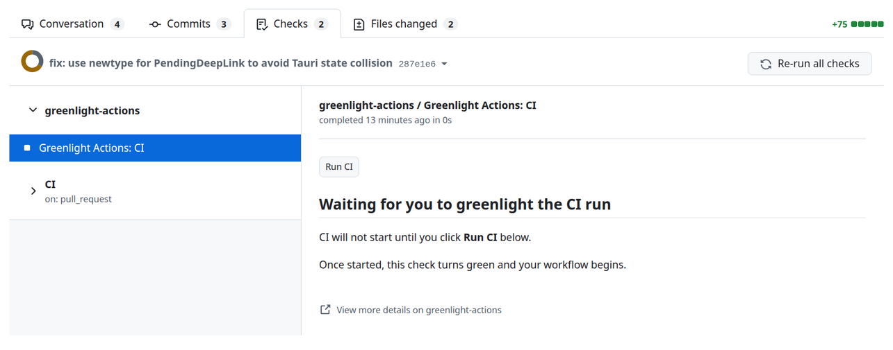
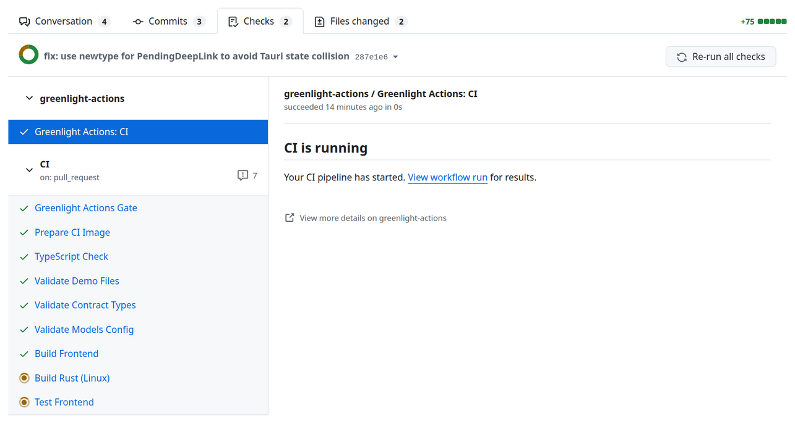

I'm a backend/DevOps engineer. And I've run into this a lot of times: I want a more refined setting for CI than just running everything on every push.

I've worked with jobs that were expensive enough that doing that added up quickly. But I've had the same annoyance in personal projects too. Sometimes I'm pushing intermediate changes, and I don't need another full build or integration test run yet.

So I built **Greenlight Actions**. It lets you give your CI runs a greenlight when you want, directly from the PR.

## What I wanted to keep automatic

I still want quick feedback. Linting and quick tests can keep running on every push. It's the longer builds, integration tests, or jobs that call paid services that I want to hold off on.

With Greenlight, you choose which work waits for approval. Click **Run CI** on the PR check or comment `/greenlight` when you're ready. Each new commit needs fresh approval. Waiting doesn't use runner minutes.



## An example with environment mode

First, install the [GitHub App](https://github.com/marketplace/greenlight-actions). In your repository settings, create a `greenlight` environment and enable Greenlight Actions under its deployment protection rules. Creating the environment alone isn't enough.

Then add the environment to the job you want to hold back. For example, in a Node project with `lint` and `test:integration` scripts:

```yaml
name: PR checks

on:
  pull_request:

permissions:
  contents: read

jobs:
  lint:
    runs-on: ubuntu-latest
    steps:
      - uses: actions/checkout@v4
      - uses: actions/setup-node@v4
        with:
          node-version: 22
      - run: npm ci
      - run: npm run lint

  integration:
    runs-on: ubuntu-latest
    environment: greenlight
    steps:
      - uses: actions/checkout@v4
      - uses: actions/setup-node@v4
        with:
          node-version: 22
      - run: npm ci
      - run: npm run test:integration
```



Lint runs automatically. The integration job waits for approval before it gets a runner. Once you approve it, GitHub runs the job and reports its result normally.

This mode is available for public repos on all GitHub plans, or private/internal repos on Enterprise. The [complete environment example](https://github.com/praxiom-systems/greenlight-actions/blob/main/examples/environment-ci.yml) also shows how to leave post-merge pushes ungated.

## Private repos on GitHub Free

The environment protection rule has a plan restriction, so Greenlight also supports dispatch mode. This works with private repos on GitHub Free as well.

The setup is a bit different:

1. Copy the [complete dispatch example](https://github.com/praxiom-systems/greenlight-actions/blob/main/examples/dispatch-ci.yml) to `.github/workflows/greenlight-ci.yml` on your default branch.
2. Replace its demo test step with your real tests. Keep the three Greenlight inputs, run name, input validation, and approved-commit checkout and verification.
3. Keep this expensive workflow triggered only by `workflow_dispatch`, without the `greenlight` environment gate. Put quick automatic checks in a separate workflow.
4. Open a PR from a branch in the same repository and approve it with the button or `/greenlight`.

Here, no workflow run starts until approval. The workflow definition comes from the default branch, and it checks out the exact approved PR commit.

There are two checks: **Run CI** records approval, and **Dispatch CI** reports the actual workflow result. Approval being accepted doesn't mean the tests passed.

Dispatch doesn't have the usual `pull_request` event payload or synthetic merge commit. It also currently doesn't support fork PRs, merge queues, or resetting a finished result for a same-commit rerun. Workflows depending on those need adaptation. The [mode guide](https://github.com/praxiom-systems/greenlight-actions/blob/main/docs/approval-modes.md) covers these limits, including concurrent approvals.

## Why an app when GitHub already has manual workflows?

What Greenlight does is already doable in GitHub technically. This tool just makes it more intuitive and directly accessible from the PR, using a button or comment, without maintaining your own approval scripts.

It selects between the modes you've configured, preferring an enabled environment protection rule, and shows instructions when setup needs attention. It doesn't change your workflow YAML for you.

## Cost and permissions

The app is free. Normal Actions quotas and billing still apply when jobs run. Standard GitHub-hosted runners are already free for public repos, so savings depend on your runners, infrastructure, or paid services. For some projects, the benefit is simply less unnecessary work and noise.

Approvals require repository write, maintain, or admin access. The app reads GitHub metadata, without reading source files or repository secrets. The [README](https://github.com/praxiom-systems/greenlight-actions#permissions-explained) explains the requested permissions.

I've tried to make the documentation pretty comprehensive, but please let me know if you see any gaps. I'd also be interested in how you're handling this in your own pipelines.

[GitHub and setup](https://github.com/praxiom-systems/greenlight-actions) · [GitHub Marketplace](https://github.com/marketplace/greenlight-actions)

Disclosure: I built Greenlight Actions and used AI assistance to help draft and edit this post.
